<div align="center">

# 🛰️ AeroVIO Ground Station

### *Monocular Visual-Inertial Odometry · MSCKF State Estimation · 50 Hz Cascaded SO(3) Flight Control*

**Aerospace-grade real-time Ground Control Station (GCS) for autonomous drone VIO, 3D mapping & closed-loop flight.**

---

<!-- Badges -->
<p>
  <a href="LICENSE"></a>
  <a href="bridge_server.py"></a>
  <a href="index.html"></a>
  
  
</p>

<p>
  <a href="https://github.com/iamakhilan/Drones-Dashboard"></a>
  
  
  
  
</p>

[🚀 Live Demo](#-quickstart) · [📖 Docs](#-mathematical-formulations) · [🏗️ Architecture](#️-architecture) · [🐛 Issues](https://github.com/iamakhilan/Drones-Dashboard/issues)

</div>

---

<div align="center">

> Companion repo: **[Drones_S5_CD2 — Controller & VIO Stack](https://github.com/Ravish2807/Drones_S5_CD2_3D_Mapping_using_normal_monocular_camera_controlling_Visual-Inertial-Odometry-VIO/tree/drones-controller)** — the 50 Hz `drones-controller` ROS 2 node this dashboard visualizes.

</div>

---

## ✨ Why AeroVIO?

| | |
|---|---|
| 🎯 **Truthful by design** | Explicitly separates **WebSocket bridge** connectivity from **ROS 2 live-node** connectivity — no fake "connected" states. |
| ⚡ **50 Hz closed-loop** | Full cascaded pipeline at controller rate: Position → Attitude Generator → Geometric SO(3) → FSM → ArduPilot. |
| 👁️ **Frame-rigorous VIO** | Strict `T_WB` (body) vs $T_{WC} = T_{WB} \cdot T_{BC}$ (camera optical) separation. No shortcuts. |
| 🗺️ **Real 3D mapping** | 442-point `synthetic_orbit_scanned_map.pcd` reconstruction, multi-projection (Isometric / Top XY / Side XZ). |
| 🔌 **Zero-dependency bridge** | Pure stdlib Python — `http.server` + hand-rolled RFC 6455 WebSocket. No `pip install`. |
| 📡 **5 flight regimes** | Calibrated datasets: `orbit` · `hover` · `straight` · `multi_axis` · `stress` (500 pts each). |

---

## 🚀 Feature Highlights

<table>
<tr>
<td width="33%" valign="top">

#### 👁️ VIO & Perception
- Monocular feed @ 30 Hz (`/camera/image_raw`)
- KLT feature velocity vectors
- Brown-Conrady camera model overlay
- Optical reticle + epipolar toggle
- 442-landmark PCD map (`HEIGHT=1`)
- $T_{WC} = T_{WB} \cdot T_{BC}$ projection

</td>
<td width="33%" valign="top">

#### 🎛️ 50 Hz Cascaded Control
- **Outer loop:** Position/velocity tracking and desired-force computation
- **Attitude generator:** Desired thrust axis, thrust magnitude, rotation $R_d$ and quaternion $q_d$
- **Inner loop:** Geometric SO(3) attitude and angular-rate control
- FSM: `IDLE → ARMING → TAKEOFF → NAVIGATING → HOVER / FAILSAFE`
- Watchdog heartbeat + failsafe

</td>
<td width="33%" valign="top">

#### 📈 Telemetry & Transport
- 3 × 20 s rolling SVG oscilloscopes (accel / vel / pos)
- Channel toggles + hover crosshair + pause/clear/undo
- DEMO replay engine — 5 datasets @ 50 Hz
- `bridge_server.py` — HTTP + `/ws` WebSocket
- Cross-machine LAN: `ws://[IP]:8000/ws`
- Stale-warning banner + truthful status

</td>
</tr>
</table>

---

## 🏗️ Architecture

*Follow the data from sensing to estimation, control, transport, and visualization. The controller runs at 50 Hz; the dashboard consumes the bridge's normalized telemetry.*

```mermaid
flowchart LR
  %% Keep this overview deliberately compact: details live in the sections below.
  subgraph INPUTS["1 · Sensors"]
    direction TB
    CAM["Camera<br/>30 Hz"]
    IMU["IMU<br/>200 Hz"]
    AP["Autopilot status<br/>10 Hz"]
  end

  subgraph EST["2 · State estimation"]
    direction TB
    VIO["Monocular VIO / MSCKF<br/>Body pose · camera pose<br/>Sparse map (442 points)"]
    STATE["Filtered pose + twist<br/>50 Hz"]
    VIO --> STATE
  end

  subgraph CONTROL["3 · Flight control · 50 Hz"]
    direction TB
    POS["Position loop<br/>Position / velocity error"]
    GEN["Attitude generator<br/>Desired thrust · R₍d₎ · q₍d₎"]
    SO3["Geometric SO(3) loop<br/>Attitude / rate error"]
    FSM["Flight state machine<br/>Arm · takeoff · navigate · failsafe"]
    POS --> GEN --> SO3 --> FSM
  end

  subgraph GROUND["4 · Ground station"]
    direction TB
    BRIDGE["Python bridge<br/>HTTP :8000 · WebSocket /ws"]
    UI["AeroVIO dashboard<br/>3D map · camera HUD · telemetry scopes"]
    BRIDGE <--> |"Normalized JSON · ~50 Hz"| UI
  end

  CAM --> VIO
  IMU --> VIO
  AP --> STATE
  STATE --> POS
  FSM -->|"Command / telemetry contract"| BRIDGE
  STATE -. "State telemetry" .-> BRIDGE
  VIO -. "VIO telemetry" .-> BRIDGE

  classDef sensor fill:#E0F2FE,stroke:#0284C7,color:#0C4A6E,stroke-width:1.5px;
  classDef estimate fill:#F3E8FF,stroke:#9333EA,color:#581C87,stroke-width:1.5px;
  classDef control fill:#D1FAE5,stroke:#059669,color:#064E3B,stroke-width:1.5px;
  classDef bridge fill:#FEF3C7,stroke:#D97706,color:#78350F,stroke-width:1.5px;
  class CAM,IMU,AP sensor;
  class VIO,STATE estimate;
  class POS,GEN,SO3,FSM control;
  class BRIDGE,UI bridge;
```



<details>
<summary><b>🔎 Data-flow notes</b></summary>

- **DEMO mode:** `bridge_server.py` replays the bundled CSV trajectories, synthesizes body/camera poses, computes demo controller telemetry, and broadcasts normalized JSON to `/ws` clients.
- **LIVE mode:** the dashboard can connect to a bridge endpoint intended to receive normalized telemetry from a companion ROS 2 adapter. The `rclpy` live adapter and physical command forwarding remain roadmap items; this README does not imply the current bridge alone flies hardware.
- **Connection status:** bridge connectivity and ROS 2/live-data availability are separate states.

</details>

---

## 📐 Mathematical Formulations

> Equations are displayed as LaTeX instead of inline code so GitHub renders subscripts, norms, transposes, and vector operators correctly. Parameter values should be kept in sync with `bridge_server.py` and the companion `drones-controller` ROS 2 parameters.

### ① Outer Loop — Position Controller

The position and velocity tracking errors are

$$
\mathbf{e}_p = \mathbf{p} - \mathbf{p}_d, \qquad
\mathbf{e}_v = \mathbf{v} - \mathbf{v}_d.
$$

The desired force is

$$
\mathbf{F}_d = -K_p\mathbf{e}_p - K_v\mathbf{e}_v + mg\mathbf{e}_3 + m\mathbf{a}_d.
$$

| Parameter | Value |
|---|---|
| $m$ | $1.50\ \mathrm{kg}$ |
| $K_p$ | `diag(0.5, 0.5, 0.5)` |
| $K_v$ | `diag(0.2, 0.2, 0.2)` |
| $g$ | $9.81\ \mathrm{m/s^2}$ |

### ② Attitude Generator

The desired body thrust axis and thrust magnitude are

$$
\mathbf{b}_{3d} = \frac{\mathbf{F}_d}{\lVert\mathbf{F}_d\rVert},
\qquad
T_d = \lVert\mathbf{F}_d\rVert.
$$

The generator uses the thrust direction and yaw reference to construct the desired rotation $R_d \in \mathrm{SO}(3)$ and quaternion $q_d$.

### ③ Inner Loop — Geometric SO(3) Controller

The attitude and angular-velocity errors are

$$
\mathbf{e}_R = \frac{1}{2}\left(R_d^T R - R^T R_d\right)^{\vee},
\qquad
\mathbf{e}_{\omega} = \boldsymbol{\omega} - R^T R_d\boldsymbol{\omega}_d.
$$

The desired control moment is

$$
\mathbf{M}_d = -k_R\mathbf{e}_R - k_{\Omega}\mathbf{e}_{\omega}
               + \boldsymbol{\omega}\times J\boldsymbol{\omega}.
$$

| Parameter | Value |
|---|---|
| $J$ | `diag(0.02, 0.02, 0.04) kg·m²` |
| $k_R$ | $[4.85,\,4.85,\,2.50]$ |
| $k_{\Omega}$ | $[0.35,\,0.35,\,0.20]$ |

### ④ Frame Extrinsics

The camera pose is derived from the body pose and the body-to-camera transform:

$$
T_{WC} = T_{WB}T_{BC},
\qquad
\mathbf{t}_{BC} = [0.10,\,0.00,\,-0.04]^T\ \mathrm{m}.
$$

The camera is mounted **10 cm forward and 4 cm downward** relative to the body frame. The dashboard can render the $T_{WB}$ and $T_{WC}$ trajectories independently.

---

## 📡 ROS 2 Topic Contracts

*Verified against `drones-controller` — rates, types, semantics.*

#### Inputs — Controller subscribes

| Topic | Type | Rate | Description |
|---|:---:|:---:|---|
| `/ap/v1/pose/filtered` | `geometry_msgs/PoseStamped` | 50 Hz | Estimated pose $p, q$ |
| `/ap/v1/twist/filtered` | `geometry_msgs/TwistStamped` | 50 Hz | Linear + angular velocity $v, \omega$ |
| `/ap/v1/status` | `ardupilot_msgs/Status` | 10 Hz | Armed / failsafe / flight state |
| `/camera/image_raw` | `sensor_msgs/Image` | 30 Hz | Monocular feed |
| `/imu/data_raw` | `sensor_msgs/Imu` | 200 Hz | 6-DOF accel + gyro |

#### Outputs — Controller publishes

| Topic | Type | Rate | Description |
|---|:---:|:---:|---|
| `/ap/v1/cmd_vel` | `geometry_msgs/TwistStamped` | 50 Hz | ArduPilot actuation |
| `/drones_controller/position_error` | `geometry_msgs/Vector3` | 50 Hz | $e_p$ |
| `/drones_controller/velocity_error` | `geometry_msgs/Vector3` | 50 Hz | $e_v$ |
| `/drones_controller/desired_force` | `geometry_msgs/Vector3` | 50 Hz | $F_d$ |
| `/drones_controller/desired_attitude` | `geometry_msgs/Quaternion` | 50 Hz | $q_d$ (+ $R_d$, $T_d$, $b_{3d}$) |
| `/drones_controller/attitude_error` | `geometry_msgs/Vector3` | 50 Hz | $e_R$ |
| `/drones_controller/angular_velocity_error` | `geometry_msgs/Vector3` | 50 Hz | $e_{\omega}$ |
| `/drones_controller/desired_moment` | `geometry_msgs/Vector3` | 50 Hz | $M_d$ |

#### VIO — Perception

| Topic | Type | Rate | Description |
|---|:---:|:---:|---|
| `/drone/vio/odometry` | `nav_msgs/Odometry` | 50 Hz | Body odometry $T_{WB}$ |
| `/drone/vio/camera_pose` | `geometry_msgs/PoseStamped` | 50 Hz | Camera optical $T_{WC}$ |
| `/drone/vio/pointcloud` | `sensor_msgs/PointCloud2` | ~5 Hz | Sparse map (442 pts) |

---

## 🧱 Tech Stack

| Layer | Technology | Notes |
|---|---|---|
| **Bridge** | Python 3.8+ · `http.server` · `hashlib`/`base64`/`struct` | Zero-dependency RFC 6455 WebSocket, `--port` / `--host` flags |
| **Frontend** | Vanilla JS (ES5 IIFE) · Tailwind CSS (CDN) · HTML5 Canvas · SVG | No build step — open `index.html` and go |
| **3D / Map** | Canvas 2D projection · PCD ASCII parser | Isometric / Top XY / Side XZ switcher |
| **Graphs** | Pure SVG · rolling 20 s window · 250-pt buffer | Spline + gradient fills · hover crosshair |
| **Data** | CSV trajectories · PCD v.7 ASCII · `real_data.js` | 5 datasets × 500 rows · 442 landmarks |
| **ROS 2** | Humble · `rclpy` adapter (planned live path) | `geometry_msgs` · `sensor_msgs` · `nav_msgs` |

<div align="center">

*No `npm install`. No `pip install`. Clone → run → fly.*

</div>

---

## ⚡ Quickstart

### Prerequisites

- **Python 3.8+** (only for the bridge — check with `python3 --version`)
- Modern browser (Chrome / Firefox / Safari)
- For LIVE mode: ROS 2 Humble + companion machine on same LAN

### 1 — Clone

```bash
git clone https://github.com/iamakhilan/Drones-Dashboard.git
cd Drones-Dashboard
```

### 2 — Start the bridge

```bash
# DEMO mode (default) — replays trajectories @ 50 Hz
python3 bridge_server.py

# Custom port / host
python3 bridge_server.py --port 8000 --host 0.0.0.0

# Help
python3 bridge_server.py --help
```

You should see:

```
[Bridge] Loaded 5 trajectory datasets: ['orbit', 'hover', 'straight', 'multi_axis', 'stress']
[Bridge] Serving HTTP on http://0.0.0.0:8000  —  WebSocket on ws://0.0.0.0:8000/ws
```

### 3 — Open the dashboard

Open **`http://localhost:8000`** in your browser.

Or just open `index.html` directly — set the WebSocket URL in the header input to `ws://localhost:8000/ws` and hit **Connect**.

### 4 — Use it

| Action | How |
|---|---|
| **Switch dataset** | Top bar pill selector — `orbit` / `hover` / `straight` / `multi_axis` / `stress` (also `?dataset=orbit` URL param) |
| **Toggle trajectories** | 3D view — $T_{WB}$ (body) vs $T_{WC}$ (camera optical) layers |
| **Change projection** | Isometric · Top (XY) · Side (XZ) buttons above 3D canvas |
| **Inspect signals** | Scroll oscilloscope graphs — hover for crosshair, toggle Ax/Ay/Az channels, Pause / Clear / Undo |
| **Search topics** | `⌘ K` or click header search — filters ROS 2 topics + params |
| **Go LIVE** | Point header WS URL to `ws://<companion-ip>:8000/ws` · flip mode toggle |

### LAN / Cross-machine

```bash
# On companion (ROS 2 machine)
python3 bridge_server.py --host 0.0.0.0 --port 8000

# On ground station — set header input to
ws://192.168.1.42:8000/ws
```

### LIVE ROS 2 (upcoming)

A thin `rclpy` adapter will subscribe to the topics above and push normalized JSON to `/ws` — dashboard stays identical. See [Roadmap](#-roadmap).

---

## ⚙️ Configuration

| Setting | Where | Default | Description |
|---|---|---|---|
| `websocketUrl` | Header input · `localStorage: aerovio.wsUrl` · `APP_CONFIG` | `ws://localhost:8000/ws` | Bridge endpoint |
| `rateHz` | `APP_CONFIG.rateHz` | `50.0` | Controller / broadcast rate |
| `massKg` | `APP_CONFIG.massKg` | `1.5` | Vehicle mass for $F_d$ |
| `gravity` | `APP_CONFIG.gravity` | `9.81` | $g$ |
| `T_BC_OFFSET` | `bridge_server.py: T_BC_OFFSET` | `{x:0.10, y:0.00, z:-0.04}` | Body→Camera extrinsic |
| `windowDurationSec` | `graphs.js` | `20.0` | Oscilloscope window |
| `--port` / `--host` | CLI flags | `8000` / `0.0.0.0` | Bridge bind |

---

## 📂 Repository Structure

```
Drones-Dashboard/
├── index.html                  # Ground station — single-page dashboard
├── bridge_server.py            # ★ Zero-dep HTTP + RFC6455 WebSocket bridge
├── css/
│   └── dashboard.css           # Light theme tokens (#F6F6F7, stone, brand)
├── js/
│   ├── websocket.js            # WS client, APP_CONFIG, reconnect, stale banner
│   ├── telemetry.js            # Telemetry engine — T_WB/T_WC, controller math
│   ├── controller.js           # SO(3) panel — e_p/e_v/F_d/b₃d/q_d/e_R/e_ω/M_d + FSM
│   ├── vio.js                  # 3D spatial map — PCD + trajectory projection
│   ├── camera.js               # Monocular HUD — KLT vectors, reticle, Brown-Conrady
│   ├── graphs.js               # 3× SVG oscilloscopes — accel/vel/pos (20 s window)
│   └── ui.js                   # Orchestrator — mode, datasets, search, modals, toasts
├── data/
│   ├── real_data.js                        # Preloaded dataset registry
│   ├── synthetic_orbit_estimated_trajectory.csv       # 500 pts — circular orbit
│   ├── synthetic_hover_estimated_trajectory.csv       # 500 pts — station-keeping
│   ├── synthetic_straight_estimated_trajectory.csv    # 500 pts — corridor
│   ├── synthetic_multi_axis_estimated_trajectory.csv  # 500 pts — coupled axes
│   ├── synthetic_stress_estimated_trajectory.csv      # 500 pts — aggressive
│   └── synthetic_orbit_scanned_map.pcd               # 442 landmarks — PCD v.7 ASCII
└── README.md
```

---

## 🗺️ Roadmap

| Status | Item |
|:---:|---|
| ✅ | Light-themed GCS with KPI cards + SO(3) matrices + topic inspector |
| ✅ | Monocular HUD — KLT vectors, reticle, Brown-Conrady params |
| ✅ | 3D map — 442-pt PCD + $T_{WB}$/$T_{WC}$ trajectories + 3 projections |
| ✅ | 50 Hz cascaded controller telemetry (outer / generator / inner / FSM) |
| ✅ | 3× 20 s SVG oscilloscopes with channel toggles + crosshair |
| ✅ | DEMO replay — 5 datasets @ 50 Hz, synthetic KLT + controller synthesis |
| ✅ | Zero-dep bridge — HTTP + `/ws` + LAN + truthful status |
| ⏳ | `rclpy` live adapter — subscribe to ROS 2 topics → normalize → `/ws` |
| ⏳ | Live IMU + camera stream from hardware (ADIS16470 / BMI088) |
| ⏳ | `/ap/v1/cmd_vel` forwarding to physical ArduPilot |
| 🔜 | Bag replay + trajectory export (CSV / PCD) |
| 🔜 | Dark mode + keyboard palette (`⌘ K`) |
| 🔜 | Unit + integration tests (bridge + math) |

---

## 🤝 Contributing

Contributions welcome — especially VIO tuning, controller gains, and ROS 2 adapter work.

```bash
# Fork & branch
git checkout -b feat/your-feature

# Keep style: vanilla JS (IIFE), no build step, stdlib Python
# Run bridge locally and verify DEMO + WS reconnect

# Commit (conventional)
git commit -m "feat: add dark-mode toggle"

# Push & open PR
git push origin feat/your-feature
```

- Open an [Issue](https://github.com/iamakhilan/Drones-Dashboard/issues) for bugs / ideas first if the change is large.
- Match existing code style — no framework introductions without discussion.
- Update topic contracts / math tables if you change gains or rates.

---

## 📄 License

[MIT](LICENSE) — © AeroVIO contributors.

---

<div align="center">

**Built for autonomous flight. Designed for clarity.**

*If AeroVIO helped your research or build, leave a ⭐ — it helps others find it.*

<br/>

<sub>Ground Station · VIO · SO(3) Control · 50 Hz · MSCKF · PCD Mapping</sub>

</div>
