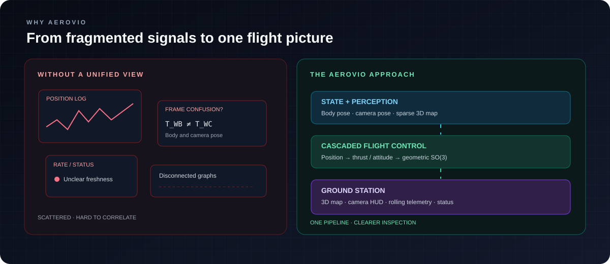
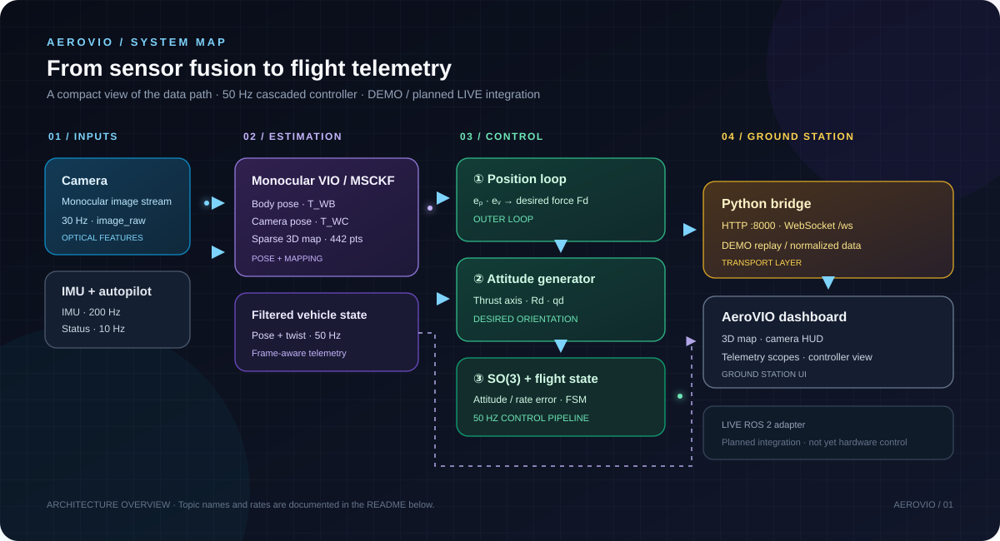
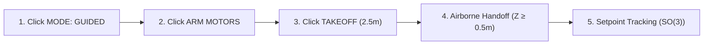

<div align="center">



<br/>

# 🛰️ AeroVIO — Ground Station for Autonomous Flight

### **See the state. Understand the flight.**

Monocular Visual-Inertial Odometry · MSCKF State Estimation · 50 Hz Geometric SO(3) Control

<p>
  <a href="https://github.com/iamakhilan/Drones-Dashboard"></a>
  <a href="https://github.com/iamakhilan/Drones-Dashboard/actions/workflows/ci.yml"></a>
  
  
  
  
  <a href="LICENSE"></a>
</p>

[Explore features](#-feature-highlights) · [Architecture](#-architecture) · [Mathematics](#-mathematical-formulations) · [Deployment Guide](#-quickstart--deployment-guide)

</div>

---

<div align="center">



</div>

> **Live Deployment Ready:** AeroVIO is an end-to-end autonomous flight ground station featuring native ROS 2 Humble DDS telemetry streaming, MAVLink UDP 14550 flight control actions (GUIDED mode, arming, takeoff, hover hold), dynamic 3D waypoint dispatching to autonomous $SO(3)$ cascaded controllers, and responsive multi-device LAN / mobile hotspot support.

---

## The flight-data problem

<table>
<tr>
<td width="50%" valign="top">

### <sub>01 / WITHOUT A UNIFIED VIEW</sub>

- Scattered telemetry and disconnected plots
- Body and camera frames are easy to confuse
- Controller signals are hard to inspect together
- Demo and live connectivity can be mistaken for one another

</td>
<td width="50%" valign="top">

### <sub>02 / THE AEROVIO APPROACH</sub>

- **One ground station** for state, map, camera, and controller telemetry
- **Explicit frame separation** for body pose and camera pose
- **Inspectable control pipeline** from position error to SO(3)
- **Honest connection states** for bridge and live ROS 2 data

</td>
</tr>
</table>

## ✨ Why AeroVIO?

| | |
|---|---|
| 🎯 **Truthful by design** | Explicitly separates **WebSocket bridge** connectivity from **ROS 2 live-node** connectivity — no fake "connected" states. |
| ⚡ **50 Hz closed-loop** | Full cascaded pipeline at controller rate: Position → Attitude Generator → Geometric SO(3) → FSM → ArduPilot. |
| 🎮 **MAVLink Flight Control** | Native UDP 14550 integration: switch to `GUIDED`, `ARM`/`DISARM`, command `TAKEOFF`, or trigger `HOLD` directly from the web UI. |
| 📍 **Dynamic Waypoint Dispatch** | Real-time $(X, Y, Z, \psi)$ coordinate dispatcher publishing directly to `/drones_controller/target_pose`. |
| 👁️ **Frame-rigorous VIO** | Strict $T_{WB}$ (body) vs $T_{WC} = T_{WB} \cdot T_{BC}$ (camera optical) separation. No shortcuts. |
| 🗺️ **Real 3D mapping** | 442-point `synthetic_orbit_scanned_map.pcd` reconstruction, multi-projection (Isometric / Top XY / Side XZ). |
| 🔌 **Zero-dependency bridge** | Pure stdlib Python — `http.server` + hand-rolled RFC 6455 WebSocket + native `rclpy` node. |
| 📱 **Hotspot & LAN Ready** | Multi-device responsive ground station accessible from any smartphone, tablet, or laptop on the local network. |

---

## 🚀 Feature Highlights

<table>
<tr>
<td width="50%" valign="top">

#### 👁️ VIO & Perception
- Monocular feed @ 30 Hz (`/camera/image_raw`)
- KLT feature velocity vectors
- Brown-Conrady camera model overlay
- Optical reticle + epipolar toggle
- 442-landmark PCD map (`HEIGHT=1`)
- $T_{WC} = T_{WB} \cdot T_{BC}$ projection

</td>
<td width="50%" valign="top">

#### 🎛️ 50 Hz Cascaded Control
- **Outer loop:** Position/velocity tracking and desired-force computation
- **Attitude generator:** Desired thrust axis, thrust magnitude, rotation $R_d$ and quaternion $q_d$
- **Inner loop:** Geometric SO(3) attitude and angular-rate control
- FSM: `IDLE → ARMING → TAKEOFF → NAVIGATING → HOVER / FAILSAFE`
- Watchdog heartbeat + failsafe bounds

</td>
</tr>
<tr>
<td width="50%" valign="top">

#### 🎮 Flight Operations & Navigation
- **8BitDo Ultimate 2C & Gamepad Teleop:** Direct RC Mode 2 joystick control from any browser (Y: Guided, A: Arm, X: Takeoff 5m, B: Brake/Hover, LB/RB: Speed switch)
- **MAVLink Flight Commands:** GUIDED mode, Arm, Disarm, Takeoff, Hold
- **Live Target Dispatch:** Input $(X, Y, Z, \text{Yaw})$ coordinates and push live setpoints
- **Airborne Handoff Integration:** Pauses velocity override on the ground to allow clean MAVLink vertical ascent before $SO(3)$ takes over
- **Real-Time Status Cards:** Armed state, flight mode, battery, and GPS fix

</td>
<td width="50%" valign="top">

#### 📈 Telemetry & Multi-Device Transport
- 3 × 20 s rolling SVG oscilloscopes (accel / vel / pos)
- Channel toggles + hover crosshair + pause/clear/undo
- Dual mode: LIVE ROS 2 DDS streaming & DEMO 50 Hz replay
- Cross-machine LAN & Mobile Hotspot (`http://[IP]:8000`)
- Low-latency RFC 6455 WebSocket telemetry streaming
- Stale-data warning banner + truthful connection watchdog

</td>
</tr>
</table>

---

## 🏗️ Architecture

<div align="center">



<sub>System overview · color-coded stages · telemetry and control paths</sub>

</div>

<details>
<summary><b>Data-flow notes</b></summary>

- **LIVE mode (Native DDS + MAVLink):** `bridge_server.py` initializes a native ROS 2 `rclpy` node subscribing directly to `/ap/v1/pose/filtered`, `/ap/v1/twist/filtered`, `/imu/data`, and all `/drones_controller/*` error and wrench topics. Simultaneously, an embedded MAVLink UDP client connects to ArduPilot SITL (`127.0.0.1:14550`) for flight mode transitions, arming, and takeoff. Target setpoints entered in the UI are published directly as `geometry_msgs/PoseStamped` on `/drones_controller/target_pose`.
- **DEMO mode:** `bridge_server.py` replays calibrated CSV trajectories, synthesizes body/camera poses, computes demo controller telemetry, and broadcasts normalized JSON to `/ws` clients at 50 Hz.
- **Connection status:** Bridge WebSocket connectivity, ROS 2 DDS live-node connectivity, and MAVLink link status are verified independently with strict truthful reporting.

</details>

---

## 📐 Mathematical Formulations

> Equations are displayed as LaTeX instead of inline code so GitHub renders subscripts, norms, transposes, and vector operators correctly. Parameter values should be kept in sync with `bridge_server.py` and the companion `drones-controller` ROS 2 parameters.

### ① Outer Loop — Position Controller

The position and velocity tracking errors are defined as:

$$
\mathbf{e}_p = \mathbf{p}_d - \mathbf{p}, \qquad
\mathbf{e}_v = \mathbf{v}_d - \mathbf{v}.
$$

The commanded acceleration and desired force are:

$$
\mathbf{a}_{\mathrm{cmd}} = K_p\mathbf{e}_p + K_v\mathbf{e}_v + \mathbf{a}_d, \qquad
\mathbf{F}_d = m(\mathbf{a}_{\mathrm{cmd}} + g\mathbf{e}_3).
$$

| Parameter | Value | Reference Source |
|---|---|---|
| $m$ | $1.50\ \mathrm{kg}$ | `config/vehicle.yaml` |
| $K_p$ | `diag(0.5, 0.5, 0.5)` | `config/controller.yaml` |
| $K_v$ | `diag(0.2, 0.2, 0.2)` | `config/controller.yaml` |
| $g$ | $9.81\ \mathrm{m/s^2}$ | `config/controller.yaml` |
| $v_{\max}$ | $0.50\ \mathrm{m/s}$ | `config/controller.yaml` |

### ② Attitude Generator

The desired body thrust axis and thrust magnitude are:

$$
\mathbf{b}_{3d} = \frac{\mathbf{F}_d}{\left\|\mathbf{F}_d\right\|},
\qquad
T_d = \left\|\mathbf{F}_d\right\|.
$$

The generator constructs the desired orthonormal rotation $R_d = [\mathbf{b}_{1d},\, \mathbf{b}_{2d},\, \mathbf{b}_{3d}] \in \mathrm{SO}(3)$ using heading reference $\psi_d$:

$$
\mathbf{b}_{2d} = \frac{\mathbf{b}_{3d} \times [\cos\psi_d,\, \sin\psi_d,\, 0]^T}{\left\|\mathbf{b}_{3d} \times [\cos\psi_d,\, \sin\psi_d,\, 0]^T\right\|}, \qquad \mathbf{b}_{1d} = \mathbf{b}_{2d} \times \mathbf{b}_{3d}.
$$

### ③ Inner Loop — Geometric SO(3) Controller

The attitude error and angular-velocity tracking errors are:

$$
\mathbf{e}_R = \frac{1}{2}\left(R_d^T R - R^T R_d\right)^{\vee},
\qquad
\mathbf{e}_{\omega} = \boldsymbol{\omega} - R^T R_d\boldsymbol{\omega}_d.
$$

The desired control moment is:

$$
\mathbf{M}_d = -k_R\mathbf{e}_R - k_{\Omega}\mathbf{e}_{\omega}
               + \boldsymbol{\omega}\times (J\boldsymbol{\omega})
               - J\left(\hat{\boldsymbol{\omega}}R^TR_d\boldsymbol{\omega}_d - R^TR_d\dot{\boldsymbol{\omega}}_d\right).
$$

| Parameter | Value | Reference Source |
|---|---|---|
| $J$ | `diag(0.02, 0.02, 0.04) kg·m²` | `config/vehicle.yaml` |
| $k_R$ | $[4.0,\, 4.0,\, 2.0]$ | `config/controller.yaml` |
| $k_{\Omega}$ | $[0.8,\, 0.8,\, 0.5]$ | `config/controller.yaml` |

### ④ Frame Extrinsics & Transformations

The camera optical pose is derived from the body pose and body-to-camera extrinsic calibration:

$$
T_{WC} = T_{WB}T_{BC} \iff \mathbf{p}_{WC} = \mathbf{p}_{WB} + R_{WB}\mathbf{p}_{BC}, \quad R_{WC} = R_{WB}R_{BC}
$$

$$
\mathbf{p}_{BC} = [0.10,\,0.00,\,0.00]^T\ \mathrm{m}, \qquad
R_{BC} = \begin{bmatrix} 0 & 0 & 1 \\ -1 & 0 & 0 \\ 0 & -1 & 0 \end{bmatrix}
$$

The monocular camera is mounted **10 cm forward** along the vehicle $+X$ axis. Body frame is ENU; camera frame is standard OpenCV optical pinhole ($+Z$ depth, $+X$ right, $+Y$ down).

---

## 📡 ROS 2 Topic Contracts

*Verified against `drones_controller` and `ardupilot_gz_bringup` running on ROS 2 Humble DDS.*

#### Controller & Navigation Topics

| Topic | Type | Rate | Frame / Semantics | Direction |
|---|:---:|:---:|---|:---:|
| `/drones_controller/target_pose` | `geometry_msgs/msg/PoseStamped` | Event | Commanded target $(x_d, y_d, z_d, \psi_d)$ dispatched from Web UI | UI Bridge ➔ Controller |
| `/ap/v1/pose/filtered` | `geometry_msgs/msg/PoseStamped` | 50 Hz | World frame body pose $T_{WB}$ from SITL EKF3 | SITL ➔ Controller & UI |
| `/ap/v1/twist/filtered` | `geometry_msgs/msg/TwistStamped` | 50 Hz | Body linear velocities and angular rates | SITL ➔ Controller & UI |
| `/ap/v1/cmd_vel` | `geometry_msgs/msg/TwistStamped` | 50 Hz | Autonomous velocity setpoint $(v_x, v_y, v_z, \dot{\psi})$ | Controller / UI ➔ SITL |
| `/ap/v1/status` | `ardupilot_msgs/msg/Status` | 10 Hz | ArduPilot armed state, flight mode, failsafe flags | SITL ➔ Controller & UI |
| `/imu/data` | `sensor_msgs/msg/Imu` | 200 Hz | Raw linear acceleration and angular rates | Gazebo/SITL ➔ UI |

#### SO(3) Controller Research Telemetry (Published to UI)

| Topic | Type | Rate | Description / Semantics |
|---|:---:|:---:|---|
| `/drones_controller/position_error` | `geometry_msgs/msg/Vector3Stamped` | 50 Hz | $\mathbf{e}_p = \mathbf{p}_d - \mathbf{p}$ (m) |
| `/drones_controller/velocity_error` | `geometry_msgs/msg/Vector3Stamped` | 50 Hz | $\mathbf{e}_v = \mathbf{v}_d - \mathbf{v}$ (m/s) |
| `/drones_controller/desired_force` | `geometry_msgs/msg/Vector3Stamped` | 50 Hz | $\mathbf{F}_d = m(\mathbf{a}_{\mathrm{cmd}} + g\mathbf{e}_3)$ total force vector (N) |
| `/drones_controller/desired_attitude` | `geometry_msgs/msg/PoseStamped` | 50 Hz | Desired attitude quaternion $q_d$ from thrust direction $\mathbf{b}_{3d}$ |
| `/drones_controller/attitude_error` | `geometry_msgs/msg/Vector3Stamped` | 50 Hz | $\mathbf{e}_R = \frac{1}{2}(R_d^T R - R^T R_d)^\vee$ (rad) |
| `/drones_controller/angular_velocity_error` | `geometry_msgs/msg/Vector3Stamped` | 50 Hz | $\mathbf{e}_\Omega = \boldsymbol{\omega} - R^T R_d\boldsymbol{\omega}_d$ (rad/s) |
| `/drones_controller/desired_moment` | `geometry_msgs/msg/Vector3Stamped` | 50 Hz | $\mathbf{M}_d$ control torque vector (N·m) |
| `/drones_controller/fsm_state` | `std_msgs/msg/String` | 50 Hz | Flight Manager FSM state |

#### MAVLink UDP Interface (Flight Mode & Actuation)

The bridge establishes a direct UDP socket to ArduPilot SITL (`udp:127.0.0.1:14550`):
- **Mode Switching:** Dispatches `MAV_CMD_DO_SET_MODE` to engage `GUIDED` mode (mode 4).
- **Motor Arming/Disarming:** Dispatches `MAV_CMD_COMPONENT_ARM_DISARM` (`1` = arm, `0` = disarm).
- **Autonomous Takeoff:** Dispatches `MAV_CMD_NAV_TAKEOFF` with specified altitude (default: $2.5\text{ m}$).
- **Hover Hold:** Clears velocity commands on `/ap/v1/cmd_vel` and maintains GPS station-keeping.

#### VIO Perception & Mapping

| Topic | Type | Rate | Frame / Semantics |
|---|:---:|:---:|---|
| `/drone/vio/odometry` | `nav_msgs/msg/Odometry` | 50 Hz | Body odometry $T_{WB}$ in ENU |
| `/drone/vio/camera_pose` | `geometry_msgs/msg/PoseStamped` | 50 Hz | Camera optical pose $T_{WC} = T_{WB}T_{BC}$ |
| `/drone/vio/pointcloud` | `sensor_msgs/msg/PointCloud2` | 20 Hz | Triangulated sparse visual landmarks (ENU) |

> **VIO Scale & Obstacle Disclaimer:** Monocular VIO triangulates sparse visual feature points. Metric scale is observable only under dynamic IMU acceleration excitation. Sparse feature points do not provide certified metric obstacle proximity, collision margins, or dense geometric object classification.

---

## 🧱 Tech Stack

| Layer | Technology | Notes |
|---|---|---|
| **Bridge** | Python 3.8+ · `http.server` · `hashlib`/`base64`/`struct` | Zero-dependency RFC 6455 WebSocket, `--port` / `--host` flags |
| **Frontend** | Vanilla JS (ES5 IIFE) · Tailwind CSS (CDN) · HTML5 Canvas · SVG | No build step — open `index.html` and go |
| **3D / Map** | Canvas 2D projection · PCD ASCII parser | Isometric / Top XY / Side XZ switcher |
| **Graphs** | Pure SVG · rolling 20 s window · 250-pt buffer | Spline + gradient fills · hover crosshair |
| **Data** | CSV trajectories · PCD v.7 ASCII · `real_data.js` | 5 datasets × 500 rows · 442 landmarks |
| **ROS 2** | Humble · `rclpy` adapter (`ros2_adapter/`) | `geometry_msgs` · `sensor_msgs` · `nav_msgs` |

<div align="center">

*No `npm install`. No `pip install`. Clone → run → fly.*

</div>

---

## ⚡ Quickstart & Deployment Guide

### Prerequisites

- **OS:** Linux (Ubuntu 22.04 LTS recommended)
- **ROS 2:** Humble Hawksbill (desktop or base)
- **Simulator & Autopilot:** Gazebo Harmonic + ArduPilot SITL (bare DDS / micro-ROS)
- **Python:** 3.8+ with `numpy` (MAVLink submodule included in ArduPilot)
- **Browser:** Any modern browser (Chrome, Firefox, Safari, Edge, Mobile Safari/Chrome)

---

### 🖥️ Full 3-Terminal Launch Sequence

To run the complete autonomous simulation, cascaded $SO(3)$ controller, and real-time AeroVIO ground station:

#### Terminal 1 — Gazebo Harmonic & ArduPilot SITL
Launch the runway world, Iris quadrotor model, and ArduPilot DDS bridge:
```bash
source /opt/ros/humble/setup.bash
source ~/ardu_ws/install/setup.bash
export ROS_DOMAIN_ID=0
export RMW_IMPLEMENTATION=rmw_fastrtps_cpp

ros2 launch ardupilot_gz_bringup iris_runway.launch.py
```
> *Wait until Gazebo renders and the terminal displays `ArduPilot SITL ready` with active DDS publishers.*

#### Terminal 2 — Autonomous 50 Hz SO(3) Controller
Launch the cascaded position and geometric attitude controller:
```bash
source /opt/ros/humble/setup.bash
source ~/ardu_ws/install/setup.bash
export ROS_DOMAIN_ID=0
export RMW_IMPLEMENTATION=rmw_fastrtps_cpp

ros2 launch drones_controller controller.launch.py
```
> *The controller initializes in standby with airborne safety suppression enabled (`min_takeoff_altitude: 0.50m`). It listens for target poses on `/drones_controller/target_pose`.*

#### Terminal 3 — AeroVIO Ground Station Bridge
Start the zero-dependency HTTP web server, WebSocket telemetry broadcaster, and MAVLink UDP flight controller:
```bash
source /opt/ros/humble/setup.bash
source ~/ardu_ws/install/setup.bash
cd ~/ardu_ws/src/Drones-Dashboard

python3 bridge_server.py --host 0.0.0.0 --port 8000 --mode live
```
> *Terminal displays `AeroVIO Ground Station Bridge Running` with `Operating Mode: LIVE` and `ROS 2 Connected: True`.*

---

### 📱 Cross-Device & Mobile Hotspot Deployment

You can access the ground station and command the drone from **any smartphone, tablet, or secondary laptop** connected to the same Wi-Fi or mobile personal hotspot.

1. **Find your host machine's local IP address:**
   ```bash
   ip route get 1.1.1.1 | awk '{print $7}'
   # Example output: 10.105.86.215
   ```

2. **Open the Dashboard in any browser:**
   ```
   http://10.105.86.215:8000
   ```
   *(Or `http://localhost:8000` when viewing on the host PC).*

3. **FastDDS Multi-Interface Discovery (Optional for distributed ROS 2):**
   If running ROS 2 nodes or MATLAB across distinct machines on the same hotspot, ensure your active IP is included in `~/fastdds_whitelist.xml`:
   ```xml
   <profiles xmlns="http://www.eprosima.com/XMLSchemas/fastRTPS_Profiles">
       <transport_descriptors>
           <transport_descriptor>
               <transport_id>CustomUDPTransport</transport_id>
               <type>UDPv4</type>
               <interfaceWhiteList>
                   <address>127.0.0.1</address>
                   <address>10.105.86.215</address>
               </interfaceWhiteList>
           </transport_descriptor>
       </transport_descriptors>
   </profiles>
   ```

---

### 🎮 In-Flight Operations Walkthrough

Once all three terminals are active and the web dashboard is open:



1. **Verify Connection:** Confirm that the header status pills display **Bridge: Connected** and **ROS 2: Connected**.
2. **Switch to GUIDED Mode:** In the **Flight Control & Target Setpoint** panel, click `MODE: GUIDED`. The flight state indicator updates to `GUIDED`.
3. **Arm Vehicle:** Click `ARM MOTORS`. The quadrotor propellers will spin up in Gazebo, and the status turns to `ARMED: TRUE`.
4. **Initiate Takeoff:** Click `TAKEOFF (2.5M)`. ArduPilot executes a smooth vertical ascent to $2.5\text{ m}$.
   - **Automatic Airborne Handoff:** The $SO(3)$ controller pauses velocity overrides while on the ground ($Z < 0.50\text{ m}$) to prevent ground friction/drag from interfering with ArduPilot's native ascent. As soon as altitude crosses $0.50\text{ m}$, the controller outputs:
     ```
     [INFO] Drone is airborne (Altitude: 0.52m >= 0.50m) - Autonomous SO(3) velocity tracking ENGAGED!
     ```
5. **Dispatch Autonomous Target Coordinates:**
   - Enter your target coordinates in the panel inputs, e.g.:
     `X: 20.0` · `Y: 5.0` · `Z: 20.0` · `Yaw: 2.0 rad`
   - Click **`DISPATCH TARGET`**.
   - The bridge immediately publishes to `/drones_controller/target_pose`. The controller computes the position tracking error $\mathbf{e}_p$, constructs desired rotation $R_d \in \mathrm{SO}(3)$, and smoothly navigates the drone to the target in Gazebo!
6. **Live Telemetry & Diagnostics:**
   - Observe real-time 3D trajectory tracking ($T_{WB}$ vs $T_{WC}$) on the spatial map.
   - Inspect tracking error convergence ($\mathbf{e}_p, \mathbf{e}_v$) on the SVG oscilloscopes.
   - Monitor optical feature vectors and Brown-Conrady camera parameters on the Monocular HUD.
7. **Emergency Hold:** Click `HOLD POSITION` to zero out velocity commands and hover in place.

---

### 🧪 Offline DEMO Replay Mode

If running on a machine without ROS 2 or Gazebo installed, AeroVIO provides an analytical 50 Hz replay engine:
```bash
python3 bridge_server.py --mode demo --port 8000
```
- Replays calibrated trajectory datasets: `orbit`, `hover`, `straight`, `multi_axis`, and `stress`.
- Evaluates the full outer-loop and inner-loop $SO(3)$ equations analytically at 50 Hz.
- Renders the 442-point `synthetic_orbit_scanned_map.pcd` reconstruction map.

---

## ⚙️ Configuration

| Setting | Where | Default | Description |
|---|---|---|---|
| `websocketUrl` | Header input · `localStorage: aerovio.wsUrl` · `APP_CONFIG` | `ws://localhost:8000/ws` | Bridge endpoint |
| `rateHz` | `APP_CONFIG.rateHz` | `50.0` | Controller / broadcast rate |
| `massKg` | `APP_CONFIG.massKg` | `1.5` | Vehicle mass for $F_d$ |
| `gravity` | `APP_CONFIG.gravity` | `9.81` | $g$ |
| `T_BC_OFFSET` | `bridge_server.py: T_BC_OFFSET` | `{x:0.10, y:0.00, z:-0.04}` | Body→Camera extrinsic |
| `windowDurationSec` | `graphs.js` | `20.0` | Oscilloscope window |
| `--port` / `--host` | CLI flags | `8000` / `0.0.0.0` | Bridge bind |

---

## 📂 Repository Structure

```
Drones-Dashboard/
├── index.html                  # Ground station — single-page dashboard
├── bridge_server.py            # ★ Zero-dep HTTP + RFC6455 WebSocket bridge
├── css/
│   └── dashboard.css           # Light theme tokens (#F6F6F7, stone, brand)
├── js/
│   ├── websocket.js            # WS client, APP_CONFIG, reconnect, stale banner
│   ├── telemetry.js            # Telemetry engine — T_WB/T_WC, controller math
│   ├── controller.js           # SO(3) panel — e_p/e_v/F_d/b₃d/q_d/e_R/e_ω/M_d + FSM
│   ├── vio.js                  # 3D spatial map — PCD + trajectory projection
│   ├── camera.js               # Monocular HUD — KLT vectors, reticle, Brown-Conrady
│   ├── graphs.js               # 3× SVG oscilloscopes — accel/vel/pos (20 s window)
│   └── ui.js                   # Orchestrator — mode, datasets, search, modals, toasts
├── data/
│   ├── real_data.js                        # Preloaded dataset registry
│   ├── synthetic_orbit_estimated_trajectory.csv       # 500 pts — circular orbit
│   ├── synthetic_hover_estimated_trajectory.csv       # 500 pts — station-keeping
│   ├── synthetic_straight_estimated_trajectory.csv    # 500 pts — corridor
│   ├── synthetic_multi_axis_estimated_trajectory.csv  # 500 pts — coupled axes
│   ├── synthetic_stress_estimated_trajectory.csv      # 500 pts — aggressive
│   └── synthetic_orbit_scanned_map.pcd               # 442 landmarks — PCD v.7 ASCII
└── README.md
```

---

## 🗺️ Roadmap

| Status | Item |
|:---:|---|
| ✅ | Light-themed GCS with KPI cards + SO(3) matrices + topic inspector |
| ✅ | Monocular HUD — KLT vectors, reticle, Brown-Conrady params |
| ✅ | 3D spatial map — 442-pt PCD + $T_{WB}$/$T_{WC}$ trajectories + 3 projections |
| ✅ | 50 Hz cascaded controller telemetry (outer / generator / inner / FSM) |
| ✅ | 3× 20 s SVG oscilloscopes with channel toggles + crosshair |
| ✅ | DEMO replay — 5 datasets @ 50 Hz, synthetic KLT + controller synthesis |
| ✅ | Zero-dep bridge — HTTP + `/ws` + LAN + truthful status |
| ✅ | Native ROS 2 Humble DDS node embedded in `bridge_server.py` |
| ✅ | Direct MAVLink UDP 14550 flight commander (GUIDED, ARM, TAKEOFF, HOLD) |
| ✅ | Real-time dynamic waypoint target dispatching (`/drones_controller/target_pose`) |
| ✅ | Multi-device Wi-Fi / Hotspot LAN deployment (`0.0.0.0:8000`) |
| ✅ | Airborne handoff safety logic integration (`min_takeoff_altitude: 0.50m`) |
| ⏳ | Live IMU + camera stream from physical hardware (ADIS16470 / BMI088) |
| ⏳ | Physical Pixhawk hardware bench flight verification |
| 🔜 | Bag replay + trajectory export (CSV / PCD) |
| 🔜 | Dark mode + keyboard palette (`⌘ K`) |
| 🔜 | Automated end-to-end integration test suite |

---

## 🛠️ Development

```bash
# Run the bridge (DEMO replay @ 50 Hz)
npm run dev          # = python bridge_server.py

# Full test suite (15 tests: controller math, transforms, REST endpoints)
npm test             # = python test_bridge_and_math.py

# Tailwind CSS
npm run build        # one-shot minified build -> css/output.css
npm run watch:css    # watch mode
npm run build:css    # direct build step
```

- **Formatting:** `.editorconfig` enforces LF, 4-space Python, 2-space JS/HTML/CSS.
  `.prettierrc` matches the existing frontend style (single quotes, semicolons,
  100-col JS) — run `npx prettier --write js/ css/ index.html` when touching frontend files.
- **CI:** `.github/workflows/ci.yml` runs on push/PR — Python compile checks, `node --check`
  on first-party JS (vendored Three.js bundles excluded), Tailwind build assert, the full
  15-test suite, and a live WebSocket smoke test (handshake `/ws`, assert telemetry ≤ 10 s).
- **Large assets:** trajectory CSVs, the PCD map, and PNGs are Git LFS candidates.
  `.gitattributes` ships with the patterns commented — see [`docs/lfs-migration.md`](docs/lfs-migration.md)
  before enabling LFS on existing history.

---

## 🤝 Contributing

Contributions welcome — especially VIO tuning, controller gains, and ROS 2 adapter work.

```bash
# Fork & branch
git checkout -b feat/your-feature

# Keep style: vanilla JS (IIFE), no build step, stdlib Python
# Run bridge locally and verify DEMO + WS reconnect

# Commit (conventional)
git commit -m "feat: add dark-mode toggle"

# Push & open PR
git push origin feat/your-feature
```

- Open an [Issue](https://github.com/iamakhilan/Drones-Dashboard/issues) for bugs / ideas first if the change is large.
- Match existing code style — no framework introductions without discussion.
- Update topic contracts / math tables if you change gains or rates.

---

## 📄 License

[MIT](LICENSE) — © AeroVIO contributors.

---

<div align="center">

**Built for autonomous flight. Designed for clarity.**

*If AeroVIO helped your research or build, leave a ⭐ — it helps others find it.*

<br/>

<sub>Ground Station · VIO · SO(3) Control · 50 Hz · MSCKF · PCD Mapping</sub>

</div>
